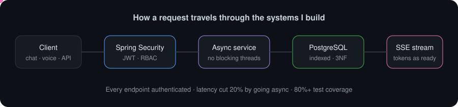

  
  
  

I'm a backend engineer with 4 years of shipping Java and Spring Boot microservices on AWS. I like systems that stay fast, safe and understandable under real load: async by default, every endpoint authenticated, every change tested.

> 🇪🇬 بشتغل backend من 4 سنين. بحب الحاجة اللي تفضل شغالة صح لما الضغط يزيد، من غير مفاجآت.

## What I've shipped

| | |
|---|---|
| **1.4M records, 0 lost** | Merged three production databases (Oracle, MySQL, MongoDB) into one 3NF PostgreSQL model of 30 tables with a Python ETL pipeline. 39,000 identities, 3,300 duplicates reconciled. |
| **-20% chat latency** | Replaced blocking request handling with async processing and server-sent streaming across distributed Spring Boot services for an AI chat, streaming and voice platform. |
| **Untrusted code, safely** | Built multi-language runners that execute user Java, Python and JavaScript inside resource-capped Docker containers and bubblewrap sandboxes. |
| **Payments that don't double-charge** | Led a Bambora (Worldline) billing layer on a live merchant account and fixed the cross-replica and timeout double-charges. |
| **-30% deployment errors** | Automated builds and releases to AWS EC2 with GitHub Actions. |
| **20 GB video uploads** | Fixed an AWS pipeline (S3 multipart, MediaConvert, MediaPackage HLS, SNS) so large uploads stop corrupting. |

## How I build

## Featured project: [Forsa (فرصة)](https://github.com/omar-mahmoud-java-developer/forsa)

A self-hosted job-search agent I built for myself and open-sourced. It is **dry-run by default** and answers application questions **honestly**: when it doesn't know something, it asks me by email instead of guessing. It runs on a schedule, scores jobs, and tracks every application. It targets Egypt and the Gulf.

## Toolbox

  

**Also:** Spring Security · JWT · OAuth 2.0 · RBAC · JUnit · Mockito · Stripe · SSE · Microservices

## Live pulse

That card rebuilds itself every night with a GitHub Action in this repo (`scripts/pulse.py`). Nothing to maintain.

## Let's talk

I'm open to senior backend roles, especially in Egypt and the Gulf. Best way to reach me is [LinkedIn](https://www.linkedin.com/in/omar-qenawy12).
